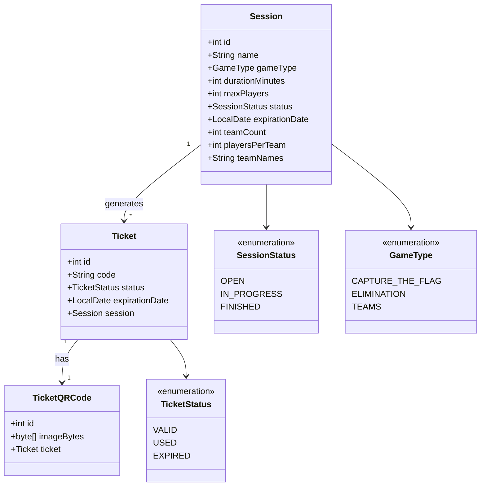

# LaserArena

A desktop app to manage laser tag sessions with QR code ticketing. Operators create game sessions, generate a unique QR code ticket for each player, and control access to the arena by scanning tickets with a barcode scanner. Each scan instantly tells whether a ticket is valid, already used or expired.

## Features

- **Session management**: create sessions with a game mode (elimination, team match, capture the flag), duration, player limit and team setup
- **Ticket generation**: one unique ticket per player, with its own QR code
- **Access control**: scan tickets with a handheld barcode scanner and get an instant valid / used / expired result
- **Cascade deletion**: deleting a session cleans up its tickets and QR codes

## Tech Stack

- Java with JavaFX and FXML for the UI
- Maven for build and dependencies
- JUnit for unit tests
- Relational database accessed through a repository layer

The app follows the **MVC** pattern. A `NavigationHelper` centralizes navigation between FXML views to keep controllers lean.

## Getting Started

### Prerequisites

- JDK and Maven
- Optional: a USB barcode scanner (it acts as a keyboard, so tickets can also be typed manually)

### Run the app

```bash
git clone https://github.com/veon-mc/laser-arena.git
cd laser-arena/LaserArena
mvn javafx:run
```

The database URL is set in `config.properties`.

### Run the tests

```bash
mvn test
```

## Data Model



> Class and field names are translated here for readability; in the source code they are in French (`Billet`, `StatutBillet`, etc.).

## Known Issues

- With some keyboard layouts, the D5100Y scanner sends `§` instead of `-` in ticket UUIDs. The `ScannerController` replaces it automatically, but other special characters may still be affected depending on the machine's keyboard configuration.

## Authors

- Michael Lepomme
- Ali Kadhem

Built as a team project at HE2B ESI (2025–2026).
