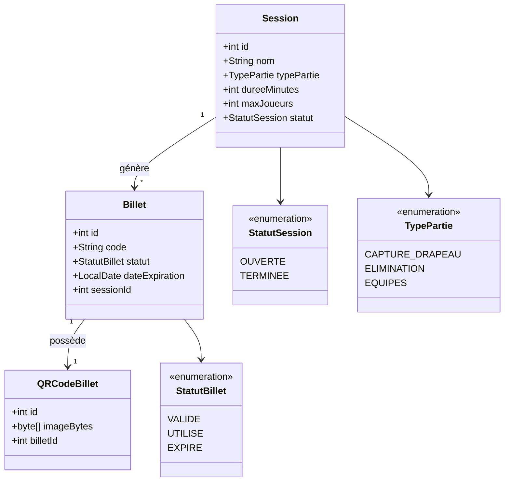

# LaserArena – Gestion de sessions de lasergame avec QR Code

## Auteurs

- Groupe C131
- g64889 Lepomme Michael
- g66076 Ali Kadhem

## Description du Projet

Ce projet est une application permettant de gérer des sessions de lasergame. Un
opérateur peut créer des sessions de jeu, générer des billets uniques associés à
un QR code pour chaque joueur, et contrôler l'accès à l'arène en scannant les
billets à l'aide d'une douchette. L'application vérifie instantanément si un billet
est valide, déjà utilisé ou expiré.

## Diagramme de Classe

Le diagramme de classe ci-dessous illustre la structure du modèle de l'application.



## Choix de l'Architecture

L'architecture retenue pour ce projet est Model-View-Controller (MVC), avec JavaFX
et FXML pour les vues.

## Plan de Tests Fonctionnels

Les tests fonctionnels élémentaires pour le projet sont les suivants :

- Créer une session de jeu et vérifier qu'elle apparaît dans la liste des sessions.
- Générer un billet pour une session et vérifier que son statut est VALIDE.
- Générer le QR code associé à un billet et vérifier que l'image est bien créée.
- Scanner un billet VALIDE : vérifier que son statut passe à UTILISE.
- Scanner un billet déjà UTILISE : vérifier que l'application affiche un message d'erreur.
- Scanner un billet EXPIRE : vérifier que l'application affiche un message d'erreur.
- Scanner un code inexistant : vérifier que l'application affiche un message d'erreur.

## Calendrier Hebdomadaire des Tâches

### Semaine 1 – 6H
| Qui | Description |
|--------|--------------------------------------|
| Tous | Analyse du projet, validation README |
| Michael | Initialisation du dépôt Git et structure du projet Maven |
| Ali | Création des vues FXML principales |

### Semaine 2 – 6H
| Qui | Description |
|--------|--------------------------------------|
| Michael | Implémentation du modèle (Session, Billet, QRCodeBillet) |
| Ali | Implémentation de la base de données et des Repository |

### Semaine 3 – 6H
| Qui | Description |
|--------|--------------------------------------|
| Michael | Génération des QR codes et intégration dans l'UI |
| Ali | Lecture douchette et logique de validation des billets |

### Semaine 4 – 6H
| Qui | Description |
|--------|--------------------------------------|
| Michael | Tests unitaires du modèle |
| Ali | Tests unitaires des Repository |

### Semaine 5 – 6H
| Qui | Description |
|--------|--------------------------------------|
| Tous | Corrections, finalisation, vidéo de démonstration |

## Installation et utilisation

Pour utiliser l'application, suivez les étapes suivantes :

1. Clonez ce repository :
```
git clone https://git.esi-bru.be/2025-2026/4prj1d/c131/projects/64889-66076-lepomme-khadem
```

2. Déplacez vous dans le dossier LaserArena :
```
cd LaserArena/
```

3. Démarrez le projet en exécutant la commande :
```
mvn javafx:run
```

## Problèmes connus de l'application

Lors de la réalisation des tests fonctionnels, nous avons constaté les problèmes
suivants :

- La douchette D5100Y envoie parfois le caractère `§` à la place du tiret `-` dans les UUID. Un remplacement automatique a été ajouté dans le `ScannerController`, mais d'autres caractères spéciaux pourraient poser problème selon la configuration clavier de la machine.
- L'application ne gère pas la vérification automatique de l'expiration des billets : un billet dont la date d'expiration est dépassée reste au statut `VALIDE` en base tant qu'il n'est pas scanné. Une tâche planifiée (ScheduledExecutorService) pourrait résoudre ce problème.
- La connexion à la base de données est partagée (singleton) et n'est pas fermée proprement à la fermeture de l'application.

## Retrospective

Nous avons constaté les différences suivantes entre le diagramme de classes imaginé
au départ et l'implémentation réalisée :

- Le modèle `Session` a été enrichi par rapport à l'analyse initiale avec les champs `nombreEquipes`, `joueursParEquipe` et `nomsEquipes` pour supporter les modes de jeu par équipes (EQUIPES et CAPTURE_DRAPEAU), qui n'avaient pas été prévus dans le diagramme original.
- Le diagramme initial ne prévoyait pas de `NavigationHelper` : cette classe utilitaire a été ajoutée pour centraliser la navigation entre les vues FXML et éviter la duplication de code dans les controllers.
- L'URL de la base de données, initialement codée en dur, a été externalisée dans un fichier `config.properties` pour respecter les bonnes pratiques.
- La suppression en cascade (session → billets → QR codes) n'était pas prévue dans l'analyse initiale mais s'est avérée nécessaire pour éviter les données orphelines en base.